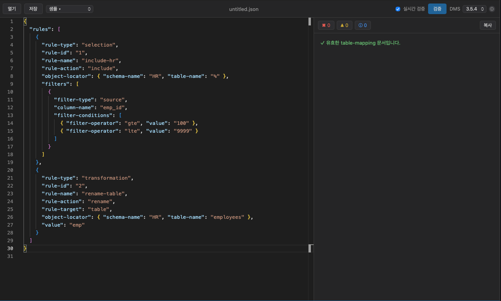

# DMS Table Mapping Validator

AWS DMS의 **table-mapping JSON**을 작성하면서, AWS에 올리기 전에 로컬에서 바로 오류를 잡아주는 데스크톱 앱입니다.
AWS 자격증명도 네트워크도 필요 없습니다. 입력한 JSON은 어디로도 전송되지 않고 전부 내 컴퓨터 안에서만 검증됩니다.

<p align="center">
  
</p>

> 왼쪽에 table-mapping JSON을 붙여넣으면, 오른쪽에 오류·경고가 실시간으로 뜹니다.
> 문제가 없으면 위처럼 초록 체크가 표시됩니다.

## 왜 쓰나요

AWS DMS의 table-mapping은 JSON 문법만 맞으면 콘솔에서 일단 통과되지만,
실제 마이그레이션 작업을 만들 때가 되어서야 `explicit`에 와일드카드를 쓸 수 없다거나,
필터 연산자에 값이 빠졌다거나 하는 규칙 위반이 드러나곤 합니다.

이 앱은 그 규칙들을 **작성하는 그 자리에서** 알려줍니다.

- ✅ AWS에 올리기 전에 규칙 위반을 미리 발견
- ✅ 오류 위치를 `줄:칸`까지 정확히 표시하고, 클릭하면 에디터의 해당 위치로 이동
- ✅ 한국어 + 영어 메시지와 함께 관련 **AWS 공식 문서 링크** 제공
- ✅ 완전 오프라인 — JSON이 외부로 나가지 않음

## 주요 기능

| 기능 | 설명 |
| --- | --- |
| **실시간 검증** | 타이핑하는 동안 자동으로 검증 (약 0.4초 디바운스). 끄고 수동 검증도 가능 |
| **인라인 마킹** | 에디터에서 문제가 있는 부분에 밑줄 표시, 마우스를 올리면 설명 |
| **클릭 점프** | 오른쪽 결과를 클릭하면 에디터의 해당 위치로 바로 이동 |
| **심각도 필터** | 오류 / 경고 / 정보를 칩으로 켜고 끄기 |
| **DMS 버전 게이팅** | 대상 DMS 엔진 버전을 고르면, 그 버전에서 안 되는 기능을 경고로 알려줌 |
| **샘플 템플릿** | "최소 selection", "필터 + 변환", "오류 예시(학습용)" 내장 |
| **파일 열기·저장·드래그앤드롭** | JSON 파일을 열거나, 창에 끌어다 놓기 |
| **결과 복사** | 검증 결과 전체를 클립보드로 복사 (리뷰·이슈 첨부용) |
| **CLI 동봉** | 같은 엔진을 CLI로도 제공 — CI 게이트로 사용 가능 |

## 시작하기

> 아직 미리 빌드된 설치 파일은 제공하지 않습니다. 아래처럼 소스에서 실행/빌드합니다.

**필요한 것**

- Rust (stable, 1.80+) / Cargo
- Node 18+ 와 pnpm
- macOS는 Xcode Command Line Tools, Linux는 webkit2gtk 등 — [Tauri 사전요건](https://tauri.app/start/prerequisites/) 참고

**바로 실행해보기**

```bash
pnpm install
pnpm tauri dev      # 데스크톱 앱이 실행됩니다
```

**설치용 앱(.app / .dmg 등) 빌드**

```bash
pnpm tauri build
```

## 사용법

1. 앱을 실행하면 샘플 문서가 열려 있습니다. 내 JSON으로 바꾸려면 **붙여넣기**, **열기**, 또는 창에 파일을 **드래그앤드롭** 합니다.
2. 오른쪽 패널에 결과가 실시간으로 나타납니다.
   - 문제가 없으면 `✓ 유효한 table-mapping 문서입니다.`
   - 문제가 있으면 각 항목에 코드(예: `SEM-...`), 위치, 한/영 설명, `↗ docs` 링크가 표시됩니다.
3. 결과 항목을 **클릭**하면 에디터의 해당 위치로 점프합니다.
4. 상단 **DMS** 드롭다운에서 대상 엔진 버전을 고르면, 버전별 제약(예: 데이터 마스킹 3.5.4+, 필터 혼합 연산자 3.5.0+)을 반영해 검증합니다.
5. 수정이 끝나면 **저장**하거나, **복사** 버튼으로 결과를 떠서 PR·이슈에 붙입니다.

## CLI

GUI와 똑같은 검증 엔진을 CLI로도 쓸 수 있어, CI 파이프라인에 게이트로 넣기 좋습니다.

```bash
cargo run -p dms-cli -- samples/valid-basic.json          # 사람이 읽는 출력
cargo run -p dms-cli -- --json samples/with-errors.json   # 기계용 JSON 리포트
cat mapping.json | cargo run -p dms-cli -- --dms-version 3.4.6
```

검증 오류가 있으면 종료 코드가 0이 아니므로, CI에서 그대로 실패 게이트로 쓸 수 있습니다.

## 무엇을 검증하나요

문법부터 DMS 고유 규칙까지 단계적으로 검사합니다.

- **구문** — JSON 파싱, 루트 타입, 크기 한도(2 MB), 중복 키
- **구조/스키마** — 필수 필드·타입·enum 값 (`rule-type`, `rule-action`, `filter-operator`, `data-type` 등)
- **의미/교차필드** — DMS 고유 규칙: `explicit`/`define-primary-key`/`table-settings` 와일드카드 금지, 필터 연산자별 값 검증, LOB 모드 상호배타, `rule-id`/`rule-name` 고유성 등
- **버전 게이팅** — 대상 DMS 엔진 버전에 따른 경고

> 규칙 전체 목록과 코드 체계, 검증 깊이 등 자세한 명세는 [`SPEC.md`](./SPEC.md)와
> [`docs/FIELD-CONSTRAINTS.md`](./docs/FIELD-CONSTRAINTS.md)를 참고하세요.

## 프라이버시

입력한 JSON은 외부로 전송되지 않습니다. 모든 검증은 로컬에서 수행되며,
AWS 자격증명이나 네트워크 연결이 필요하지 않습니다.

## 기여 / 개발

검증 로직은 전부 `crates/dms-core`(Rust)에 있고, 데스크톱 GUI와 CLI가 같은 엔진을 공유합니다.

```
crates/dms-core   GUI 비의존 검증 엔진 (위치보존 JSON 파서 + 규칙 + 진단)
crates/dms-cli    dms-core를 재사용하는 CLI (dms-validate)
src-tauri         Tauri 앱 (Rust 백엔드)
src               React + TypeScript + Monaco 프론트엔드
samples           검증용 예시 JSON (정상/오류)
```

```bash
cargo test     # 코어 단위 + 통합 테스트
pnpm build     # 프론트엔드 타입체크 + 번들
```

> 참고: Tauri CLI가 내부적으로 `pnpm install`을 호출하는데, pnpm 11은 빌드 스크립트를 기본 차단합니다.
> 이 저장소는 `pnpm-workspace.yaml`에 `allowBuilds: { esbuild: true }`를 두어 해결합니다.

아이콘을 다시 만들려면:

```bash
node scripts/make-icon.mjs
pnpm tauri icon src-tauri/icons/source.png
```

## 라이선스

[MIT](./LICENSE) © Return Zero Inc.
